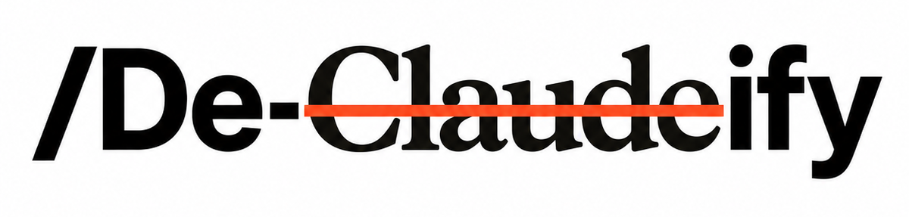
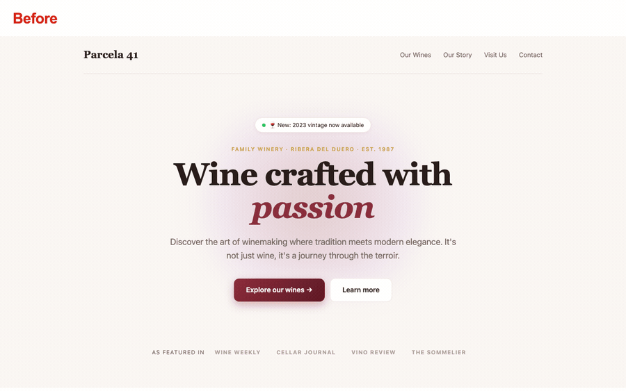
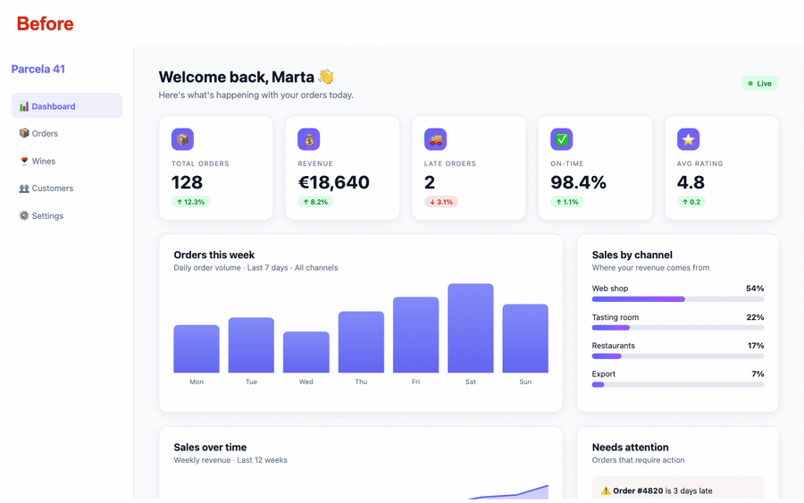
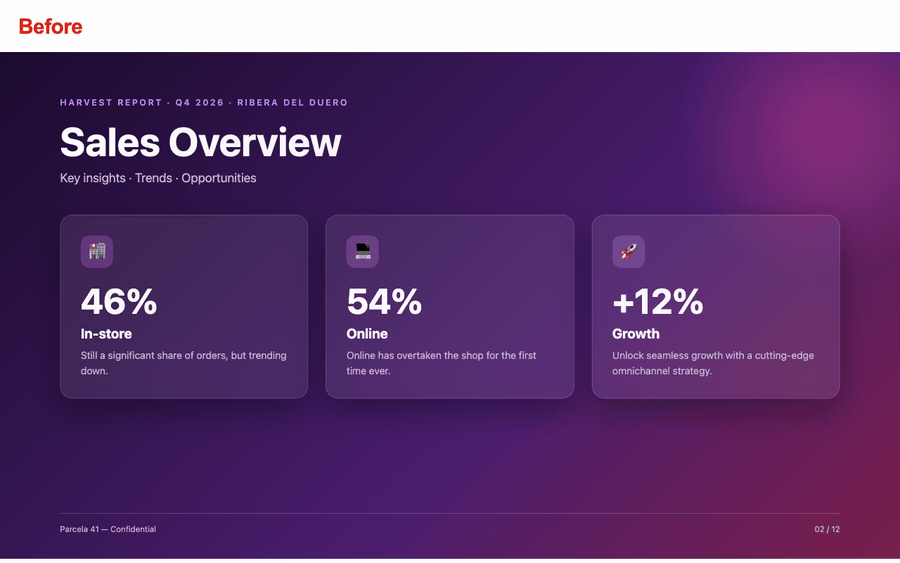

<h1 align="center"></h1>

<p align="center">Remove the habits that make a design look AI-made.</p>

An agent skill and a scanner that strip out the eyebrows, dotted subtitles, bordered cards, gradients, shadows, pills, emoji and stock marketing words that every model falls into. What is left is cleaner, calmer and looks like a person made it.



The page on the right has the same business, the same content and the same call to action as the one on the left. It has no eyebrow, no badge, no cards, no gradient, no shadow and no italic word in the headline. Scale, color and whitespace do the work the boxes were doing.

Open [`demos/index.html`](demos/index.html) in a browser to drag the slider yourself. Numbered markers point at every tell the scanner found.

## Install

You need Node 18 or newer.

```bash
git clone https://github.com/julianreves/de-claudeify.git
cd de-claudeify
node scripts/install.mjs
```

The installer finds Claude Code, Codex CLI, Cursor and OpenCode and installs the skill for each one it finds. Use `--dry-run` first to see what it would do, `--claude`, `--codex`, `--cursor` or `--opencode` to pick one, and `--remove` to uninstall.

You can also run it without cloning:

```bash
npx github:julianreves/de-claudeify install
```

## Use it

Ask your agent. The skill triggers when you build any page, deck, dashboard or UI, and whenever you say it looks AI-made.

```text
/de-claudeify a landing page for a small accounting practice
/de-claudeify clean ./site/index.html
/de-claudeify scan ./site
```

| Mode | What happens |
|---|---|
| Build | The agent designs with the rules from the first line, then scans its own output and fixes what it finds. |
| Clean | The agent takes an existing page, removes the tells and keeps the content, links, forms and scripts. It reports the count before and after. |
| Scan | The agent runs the scanner and reports. Nothing changes. |

## The scanner

The scanner runs on its own, with no dependencies. Use it in CI or by hand.

```bash
node scripts/scan.mjs path/to/site
```

```text
demos/landing/before.html
  FAIL  tracked-caps     line 21   .eyebrow { text-transform: uppercase } letter-spacing: .14em
        fix: Write the label as a plain sentence in the body face, a step smaller, in sentence case and untracked. Or delete it.
  FAIL  gradient         line 17   .hero::before { background: radial-gradient(circle, rgba(217,119,87,.25), ...
        fix: Use a flat token color. For depth, use space and size.
  FAIL  shadow           line 18   .badge { box-shadow: 0 2px 8px rgba(0,0,0,.05) }
        fix: Remove the shadow. Separate things with space. Focus rings are allowed.
  ...
36 FAIL, 27 WARN in 1 file
```

It reads `.html`, `.css`, `.jsx`, `.tsx`, `.vue`, `.svelte` and `.astro`, including inline styles, `<style>` blocks and Tailwind classes. It exits with 1 when it finds a FAIL, so it works as a CI gate.

```bash
node scripts/scan.mjs ./site --strict      # WARN fails too
node scripts/scan.mjs ./site --json        # machine-readable
node scripts/scan.mjs --list               # every rule
node scripts/scan.mjs --explain card-box   # why it exists, with a before and after
```

Or, with the CLI: `npx github:julianreves/de-claudeify scan ./site`.

## Demos

Three generated pieces for a fictional winery, each cleaned with the skill: a landing page, a dashboard and a three-slide deck. Every figure is invented, and the bottle photos are 3D renders made for the demo. The files are in [`demos/`](demos), and the interactive comparison is [`demos/index.html`](demos/index.html).

| | Before | After |
|---|---|---|
| Landing page | 43 FAIL, 25 WARN | 0 FAIL, 0 WARN |
| Dashboard | 40 FAIL, 12 WARN | 0 FAIL, 0 WARN |
| Slides | 33 FAIL, 2 WARN | 0 FAIL, 0 WARN |

**Landing page**


**Dashboard**



**Slides**



The clean versions share one grammar: Arial, solid blocks of white, black and red, type at poster scale that runs off the edge of the page, real product images, and one highlighted moment per screen. The dashboard keeps everything a working dashboard needs (navigation, filters, KPIs, charts, a table) and groups it with rules and spacing instead of rounded boxes. Lines appear where they separate sections or one wine from the next.

Counts are for version 1.0.0. The test suite checks that every before page fails, every after page is clean, and the showcase data matches the scanner. Re-render everything with `node demos/render.mjs` (needs Chrome, and ffmpeg for the GIFs). The bottle renders come from `node demos/tools/render-images.mjs`, which loads Three.js from a CDN and only needs to run if you change the images.

## What it catches

45 tells in seven groups. [`references/tells.md`](references/tells.md) has each one with the reason, the fix and an example.

| Group | Examples |
|---|---|
| Type | eyebrows, tracked small caps, dotted subtitles, an italic word in a heading, Title Case headings, headings that name a topic, emoji, a second or default font |
| Color | gradients, gradient text, cream backgrounds, clay and indigo accents |
| Shape | bordered rounded cards, filled cards, drop shadows, glass blur, badges and pills, icon tiles, callout boxes, status dots |
| Lines | rules under titles, table gridlines, colored left bars (hard fails). Section lines, header and footer lines and row dividers (warnings: keep them when they separate something) |
| Motion | `transition: all`, hover lift, fade-up and floating animations |
| Copy | clipped fragment headlines, stacked short sentences, em dashes, arrows after link text, stock words, "not X, but Y" sentences, invented proof |
| Layout | three equal cards, a row of three numbers, the "Ready to get started?" band, everything centered (checked by the agent, not the scanner) |

## The default style

The scanner and the skill assume a plain house style: one typeface (Arial), a white or black surface, one accent that means something, no boxes, no decorative lines, headings that make a claim. A line is fine when it separates ideas or sections, or carries data. It is described in [`references/style.md`](references/style.md).

A client's brand overrides it. Put a `.de-claudeify.json` file at the project root:

```json
{
  "font": "Brand Sans",
  "fontAllow": ["Georgia"],
  "disable": ["palette-cream"]
}
```

- `font` is the main font. The scanner fails any other first family. Use `null` to only warn about the fonts generated pages reach for.
- `fontAllow` lists extra families that may come first.
- `disable` switches rules off for the whole project.

Waive one finding when the tell is the point, for example a shadow on a mockup that imitates a real device. Say why:

```css
/* de-claudeify-allow: shadow -- imitates the real device */
.phone { box-shadow: 0 20px 40px #0003; }
```

Use `de-claudeify-allow-file: <id>` for a whole file, and `de-claudeify-ignore-file` to skip a file entirely.

## Check every file the agent writes

Claude Code can run the scanner after each file write and hand any FAIL back to the agent.

```bash
node ~/.claude/skills/de-claudeify/scripts/install-hook.mjs --global   # without --global: this project only
node ~/.claude/skills/de-claudeify/scripts/install-hook.mjs --remove
```

Set `"hook": false` in `.de-claudeify.json` to turn it off for one project.

## Limits

- Version 1 scans web files. Word, PowerPoint, PDF and spreadsheets follow the same rules by hand: [`references/formats.md`](references/formats.md) is the checklist. A scanner for those formats is planned.
- The scanner reads source, not the rendered page. It cannot tell that three cards look the same, or that a headline reads like a template. Those checks are in the skill, and the agent does them by eye.
- A clean scan only tells you the known tells are gone.
- The rules encode one taste. Disable the ones you disagree with.

## Contributing

Add or change a rule in `scripts/rules.mjs`, add a positive example to `tests/scan.test.mjs`, run `npm test`. See [CONTRIBUTING.md](CONTRIBUTING.md).

## License

MIT. See [LICENSE](LICENSE).

De-Claudeify is an independent project. It is not affiliated with or endorsed by Anthropic. Claude is a trademark of Anthropic, PBC.
